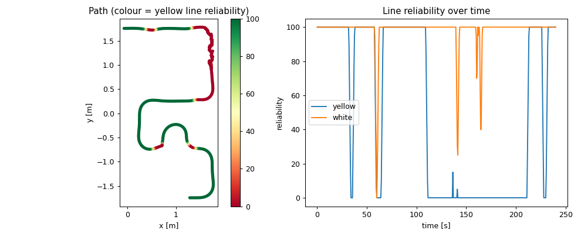

# TurtleBot3 AutoRace – Camera + LiDAR perception in simulation

Working through the ROBOTIS [TurtleBot3 Autonomous Driving](https://docs.robotis.com/docs/systems/turtlebot3/autonomous_driving/)
tutorial in Gazebo (ROS 2 Humble, Gazebo 11, `burger_cam`, world `turtlebot3_autorace_2020`), with every stage measured
rather than eyeballed: camera calibration, colour-threshold lane detection, SIFT traffic-sign recognition, traffic-light
and level-crossing detection, camera + LiDAR obstacle avoidance, and Nav2 navigation through the tunnel.
Two bugs in the upstream detectors were found and fixed along the way (see [patches/](patches/)).



## Quick start

```bash
./setup.sh                      # installs deps, clones ROBOTIS packages at the tested commits, applies patches, builds
ros2 launch turtlebot3_gazebo turtlebot3_autorace_2020.launch.py
```

## Repository layout

| Path | Contents |
|---|---|
| `01_camera_calibration/` … `07_tunnel/` | Screenshots, CSV logs and results for each tutorial stage |
| `tools/` | Measurement scripts (frame capture, run logger, projection tuner, sign tester, reference selector, level-crossing sweep) |
| `patches/turtlebot3_autorace.patch` | Fixes applied to `ROBOTIS-GIT/turtlebot3_autorace` |
| `setup.sh` | Reproducible workspace setup |

## Summary

| Task | Result |
|---|---|
| Setup (workspace, deps, `.bashrc`) | Done |
| Camera calibration – intrinsic | Done – rectified stream at 30 Hz |
| Camera calibration – extrinsic | Done – stock `projection.yaml` is optimal (lanes parallel to 0.4 %) |
| Lane detection + lane following | Done – drove the whole course; yellow lost in construction zone (geometry, not colour) |
| Traffic sign detection | intersection 5/8, right 8/8, stop 3/8, tunnel 2–4/8, parking 0/8 → 4–5/8 after fix, construction 0/8 (see below) |
| Traffic lights | Done – red/yellow/green detected with correct 5 s / 1 s / 5 s timing, no confusions |
| Intersection, Parking missions | No example code in the tutorial – nothing to run |
| Construction mission | 2/3 trials cleared the construction corner using LiDAR avoidance |
| Level crossing | Done after fixing `level.yaml` – closed→`slowdown`, open→`go` at 0.50–0.55 m |
| Tunnel mission | Done – Nav2 reached goal (`Goal succeeded`), 6 cm from target |

## Environment setup

- `~/turtlebot3_ws/src`: `turtlebot3_autorace` (humble) as the tutorial says, **plus** `turtlebot3_simulations` (humble).
  The AutoRace world loads `libtraffic_light_plugin.so` / `libtraffic_bar_plugin.so`, which are only built from source –
  that is what the tutorial's `GAZEBO_PLUGIN_PATH=$HOME/turtlebot3_ws/build/turtlebot3_gazebo` line points at.
- Environment (`~/.bashrc`):
  ```
  source /usr/share/gazebo/setup.sh
  source /opt/ros/humble/setup.bash
  source $HOME/turtlebot3_ws/install/setup.bash
  export GAZEBO_PLUGIN_PATH=$HOME/turtlebot3_ws/build/turtlebot3_gazebo:$GAZEBO_PLUGIN_PATH
  export TURTLEBOT3_MODEL=burger_cam
  ```
  `source /usr/share/gazebo/setup.sh` is not in the tutorial but was required: without it the robot's camera sensor
  failed to start (`Error advertising topic .../camera/image`) and `gzclient` crashed.

## 1. Camera calibration (`01_camera_calibration/`)

- Intrinsic: `image_proc` rectify/debayer → `/camera/image_rect_color/compressed` at 29.9 Hz (raw 30.0 Hz). Sim camera has no distortion, so this is a pass-through.
- Extrinsic: instead of moving sliders by eye, `tools/tune_projection.py` swept `top_x` through dynamic parameters and scored the
  bird's-eye image by lane parallelism (|lane width at top − lane width at bottom|):

  | top_x | 66 | 74 | 82 | **86** | 90 | 98 | 110 |
  |---|---|---|---|---|---|---|---|
  | width diff (px) | 107 | 56 | 15 | **2.2** | 18 | 47 | 82 |

  Minimum at the shipped value (527 vs 529 px), so `projection.yaml` / `compensation.yaml` were saved unchanged.
- Note: the projection/compensation nodes publish **raw** `Image` topics (`/camera/image_projected`, `/camera/image_extrinsic_calib`), not `/compressed`.

## 2. Lane detection (`02_lane_detection/`)

- Calibration mode: yellow and white masks are clean single stripes, red start pattern not leaking; reliability 100/100, lane centre 503.6 px (image centre 500).
  Stock `lane.yaml` kept.
- Lane following (`control_lane`), 4 + 3.3 min: drove the full course from the start line to the tunnel entrance (`lane_following_path.png`).
  White reliability mean 98 %. Yellow mean 52 %: it drops to 0 for ~100 s along the right edge (construction zone).
  Probing that spot showed the yellow line leaves the projection trapezoid and the white construction blocks enter the white mask –
  a geometry/occlusion limit, not a colour-threshold problem, so the thresholds were not changed.

## 3. Traffic signs (`03_traffic_signs/`)

`tools/test_signs.py` places the robot at 8 on-track poses (taken from the logged lane-following path) 0.25–0.9 m before each sign –
the repeatable equivalent of driving there with `teleop_keyboard` – and records `/detect/traffic_sign`.

| Mission / sign | Detected |
|---|---|
| intersection / intersection | 5/8 |
| intersection / right | 8/8 |
| intersection / left | 0/8 – no left-turn sign is placed in this world (the nearby sign is the parking-area sign) |
| level_crossing / stop | 3/8 |
| tunnel / tunnel | 2/8 and 4/8 (two runs) |
| parking / parking | 0/8 stock → 5/8 and 4/8 after fix |
| construction / construction | 0/8 |

Construction and parking: the sim camera is 320×240 with a very wide FOV, so these signs are only 20–40 px.
Following the tutorial's advice, I captured my own crops from `/camera/image_compensated` and picked the best by leave-one-out
(`tools/select_sign_reference.py`, views in `reference_analysis/`): no crop was matched in more than 1 of 11 other views,
because the nodes require > 8 (construction) / > 9 (parking) SIFT matches. Measured good-match counts with the original references:

- parking reference: 2–7 on parking views, ≤ 3 on construction views → a threshold of > 4 separates them;
- construction reference: max 5 on one view, ~0 otherwise → no threshold works.

So the original images were kept, and **`detect_parking_sign.py` `MIN_MATCH_COUNT` was lowered 9 → 4** (commented in the code).
Construction sign detection is not achievable with SIFT at this resolution; the construction *mission* itself does not depend on it (LiDAR).

## 4. Traffic lights (`04_traffic_lights/`)

Measured lit-lamp colour (median H,S,V): red (1, 234, 232), yellow (30, 203, 250), green (61, 192, 234).
The plugin cycles red 5 s → yellow 1 s → green 5 s; the detector logged runs of 46–50 red / 10–12 yellow / 50–54 green
(10 Hz) – exactly matching, with no wrong-colour frames, in calibration and normal mode (`test_detection_sequence.txt`).
The stock red/yellow hue ranges overlap (19–24) but the lamp hues are 1 and 30, so `traffic_light.yaml` was kept.
Observation: the red mask only captures a ring around the lamp (bright centre is less saturated), still enough for the blob detector.

## 5. Construction mission (`05_construction/`)

Camera lane following + 2D LiDAR danger zone (0.24 m ahead × 0.12 m wide) → turn 80°, drive until a lane is seen, turn back.

| Trial | Start | Result |
|---|---|---|
| 1 | (1.19, 0.25) | avoidance triggered at (1.71, 1.64), then stalled: return turn restored the heading from *mid-curve*, lane fell outside the camera ROI → "Lane Not Detected", `control_lane` stopped |
| 2 | (1.00, 0.25) | cleared in 77 s |
| 3 | (1.39, 0.28) | cleared in 68 s |

The obstacle sits on a curve, so "return to original heading" is fragile – a good fusion discussion point.

## 6. Level crossing (`06_level_crossing/`)

**Bug found:** `param/level/level.yaml` targeted node `/detect_level` with keys `red.*`, but the launched node is
`/detect_level_crossing` and declares `detect.level.red.*`. The YAML never loaded, and the code defaults are an empty range
(`lightness_l 207 > lightness_h 162`) – nothing could ever be detected.
Rewrote `level.yaml` with the correct node name/nesting and thresholds from the measured barrier red (H 0–1, S ≈ 232, V ≈ 210):
H 0–10, S 140–255, V 120–255.

Distance sweep replaying the node's own blob logic (`tools/level_distance_sweep.py`, `distance_sweep_results.txt`):
closed → `slowdown` and open → `go` on 100 % of frames at 0.50–0.55 m. Closer than ~0.47 m the red blocks exceed the
hard-coded blob `maxArea = 500`, so the `stop` state (needs ≥ 25 px blob spacing) is never reached – a limit of the code's
constants, not of the colour calibration. Normal-mode test at 0.525 m: `slowdown` 6.5–16.4 s and 26.5–31 s,
silent `go` in between – the 10 s barrier cycle (`test_mode_timeline.txt`).
(`Level Detected / STOP / GO` are only printed when a mission sends `/detect/level_crossing_order`, which no shipped launch does.)

## 7. Tunnel mission (`07_tunnel/`)

The map frame is not the Gazebo frame. Scan-matching LiDAR against `map.pgm` at three poses (0.3–1.7 cm mean residual) gave
map = world + (1.53, 0.28), no rotation, so `init_pose (0,0,0)` = world (−1.53, −0.28) and goal (1.4, −1.4) = world (−0.13, −1.68).
With the robot there, `mission_tunnel` (Nav2 + AMCL) → `Goal succeeded` 16 s after the goal, final position 6 cm from target,
passing between the obstacles; AMCL tracked ground truth (`tunnel_path_on_map.png`). `navigation.yaml` left as shipped.
The mission node publishes the initial pose with wall-clock stamps (AMCL warns "extrapolation into the future") but recovers.

## Source changes ([patches/turtlebot3_autorace.patch](patches/turtlebot3_autorace.patch))

Against `ROBOTIS-GIT/turtlebot3_autorace` @ `a714ca0` (humble):

1. `turtlebot3_autorace_detect/param/level/level.yaml` – correct node name/nesting + tuned thresholds.
2. `turtlebot3_autorace_detect/turtlebot3_autorace_detect/detect_parking_sign.py` – `MIN_MATCH_COUNT` 9 → 4.

`setup.sh` applies the patch automatically. Upstream packages are Apache-2.0 licensed by ROBOTIS.

## Re-running anything

```
ros2 launch turtlebot3_gazebo turtlebot3_autorace_2020.launch.py
ros2 launch turtlebot3_autorace_camera intrinsic_camera_calibration.launch.py
ros2 launch turtlebot3_autorace_camera extrinsic_camera_calibration.launch.py
# then e.g. detect_lane / control_lane / detect_sign mission:=... / detect_traffic_light / detect_level_crossing / mission_construction
rqt   # Plugins > Visualization > Image View for the topics above
```
`gz model -m burger_cam -x X -y Y -Y YAW` teleports the robot (used for the sign/level-crossing/tunnel set-ups).
